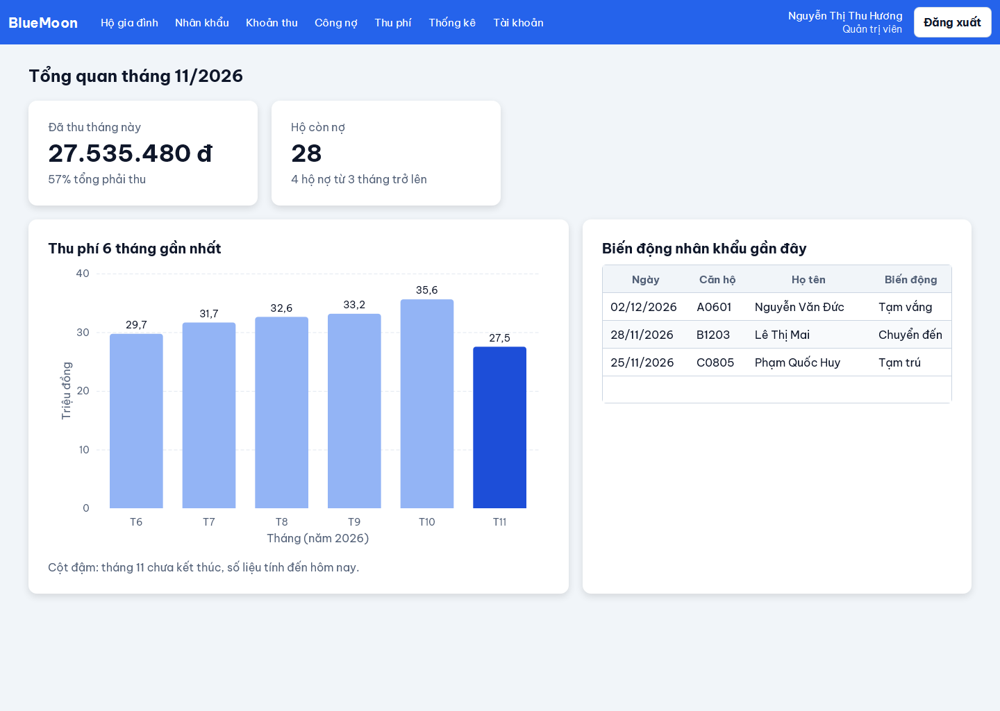
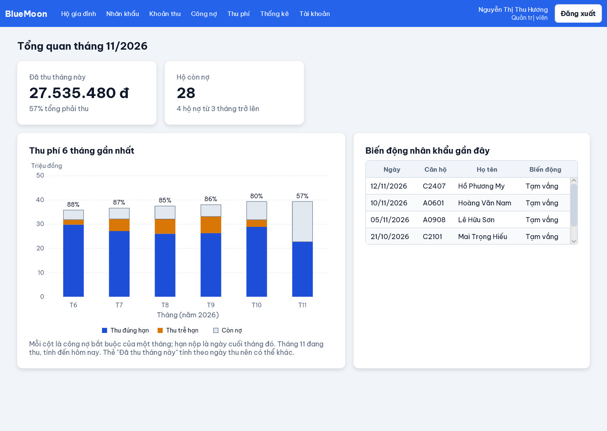
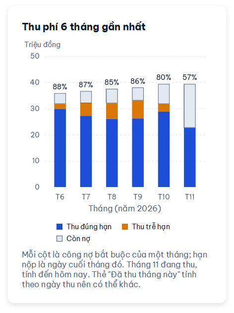

# Biểu đồ công nợ 6 tháng ở Trang chính: trước và sau

Ngày: 15/11/2026 · US-016, giả định 46 · Ảnh chụp bằng
`TrangChinhSoLieuTest` (JavaFX chạy ngầm trên Monocle, không điều khiển màn
hình), số liệu đọc qua Service thật từ một CSDL MySQL vừa nạp `schema.sql`,
`seed.sql`, `seed-demo.sql` ngày 15/11/2026. Cách chụp lại:
[testing.md](../testing.md), mục 2.

## Vấn đề của biểu đồ cũ

1. Chỉ có tổng tiền thu theo ngày thu, không cho biết thu được bao nhiêu
   phần so với phải thu, đúng hạn hay trễ.
2. Sáu cột gần như lấp kín chiều ngang.
3. Tên trục Y "Triệu đồng" xoay dọc; trên máy thật JavaFX vẽ sai dấu tiếng
   Việt khi xoay chữ.

## Trước

Trong ảnh "trước", biểu đồ và thẻ "Đã thu tháng này" là số liệu seed-demo
thật; bảng biến động bên phải là dữ liệu mẫu của test cũ.

## Sau

Ở 1120×645 có khung "Biến động nhân khẩu" bên cạnh nên biểu đồ hẹp nhất;
chú giải tự xuống dòng (ảnh riêng khung biểu đồ, vì ở cỡ này phải cuộn mới
thấy hết):

Các ảnh còn lại nằm trong thư mục
[bieu-do-cong-no](bieu-do-cong-no).

## Số liệu 6 tháng trên seed-demo (nạp ngày 15/11/2026)

Đơn vị: đồng. Đọc từ `ThongKeService.tongQuan`, khớp với truy vấn SQL viết
tay độc lập trên cùng CSDL.

| Tháng | Phải nộp | Thu đúng hạn | Thu trễ hạn | Còn nợ | Tỷ lệ đã thu | Hộ đã đóng đủ |
|---|---|---|---|---|---|---|
| 6/2026 | 35.841.840 | 29.736.120 | 1.980.960 | 4.124.760 | 88% | 32/36 |
| 7/2026 | 36.642.480 | 27.082.200 | 4.929.240 | 4.631.040 | 87% | 32/37 |
| 8/2026 | 37.502.880 | 25.985.160 | 5.966.280 | 5.551.440 | 85% | 32/38 |
| 9/2026 | 38.022.720 | 26.234.760 | 6.781.440 | 5.006.520 | 86% | 32/38 |
| 10/2026 | 39.367.080 | 28.827.960 | 2.869.920 | 7.669.200 | 80% | 31/39 |
| 11/2026 (đang thu) | 39.367.080 | 22.615.560 | 0 | 16.751.520 | 57% | 20/39 |

`seed-demo.sql` tính ngày theo ngày nạp, nên nạp vào ngày khác thì số của
tháng hiện tại khác.

Thẻ "Đã thu tháng này" trong ảnh ghi 27.535.480 đ, lớn hơn phần đúng hạn
của cột tháng 11 (22.615.560 đ): thẻ tính theo ngày thu (giả định 24), gồm
cả tiền nợ tháng trước đóng trong tháng 11 và đóng góp tự nguyện; cột tính
theo công nợ của tháng 11. Chú thích dưới biểu đồ nói rõ điều này.

## Điều cần biết khi trình bày

- Hạn nộp là ngày cuối tháng được chốt. Tháng chốt bù sau khi đã qua (giả
  định 32) thì mọi khoản thu của tháng đó là "trễ hạn".
- Hộ A1702 đóng bù tháng 8 vào ngày 18/9: 910.440 đ của hộ này nằm trong
  phần "trễ hạn" của cột tháng 8 (`SeedDemoIT` kiểm).
- "Còn nợ" dùng màu trung tính nhạt có viền, không dùng đỏ.
