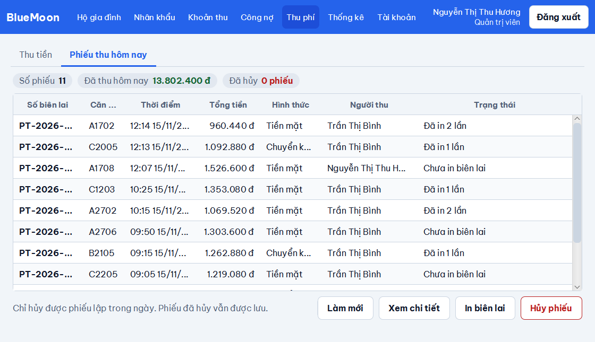
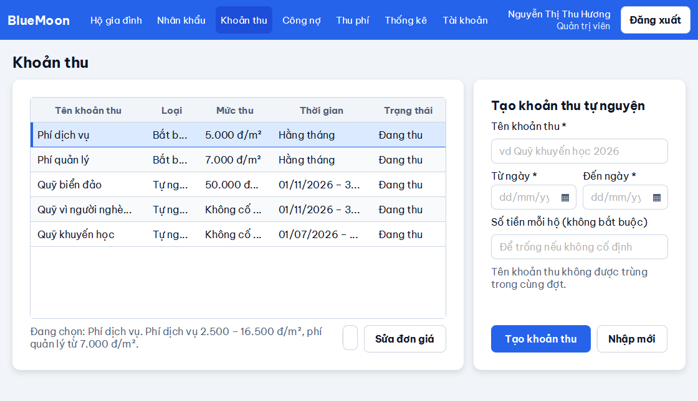
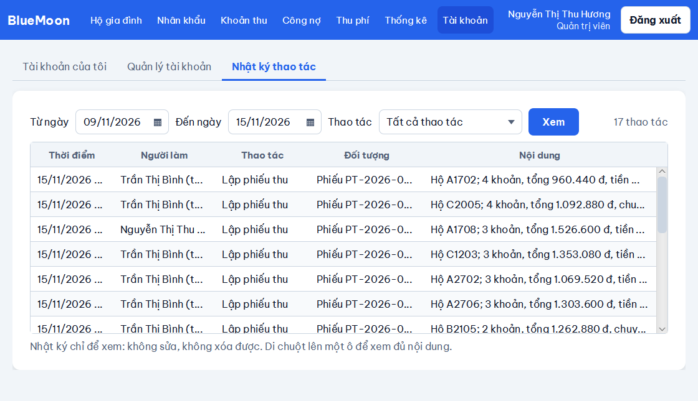
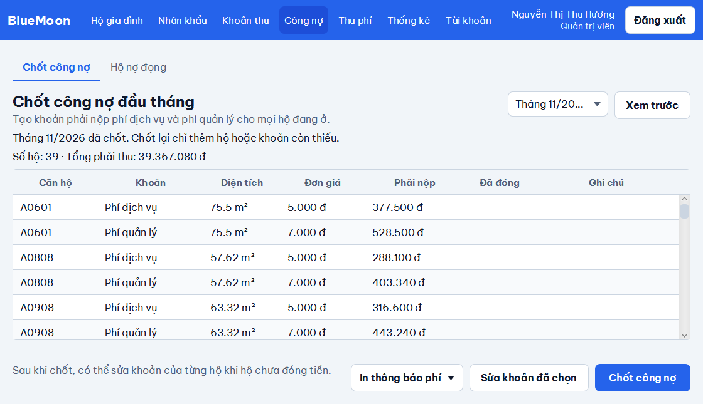
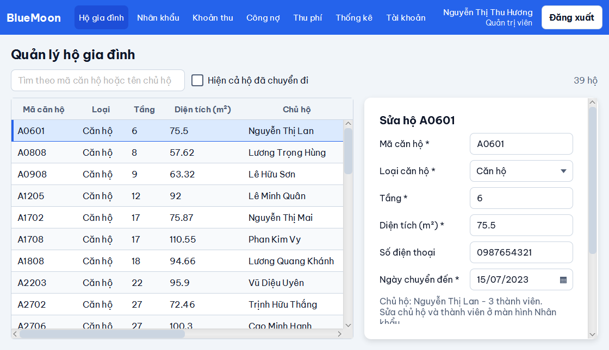
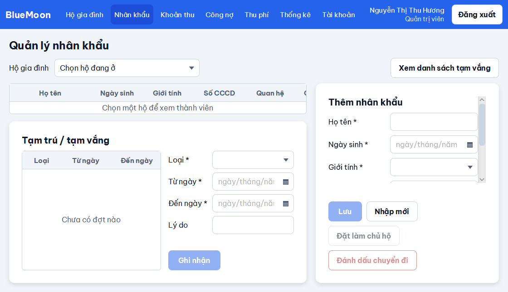

# Rà soát giao diện với dữ liệu thật

Ngày rà soát: 15/11/2026 · Phạm vi: `main` tại `45acb6e` (sau biểu đồ công
nợ, #56) · Bước 1: chỉ rà soát, không sửa mã trong Pull Request này.

## Cách rà soát

Các lần rà trước (`BoCucFxmlTest`, `ChupManHinhTest`) vẽ màn hình **không có
dữ liệu**, nên không thấy được ô bảng bị cắt chữ. Lần này dùng một test tạm
(không đưa vào repo) tải `trang-chinh.fxml` cùng **controller thật**, đăng
nhập bằng tài khoản thật rồi bấm lần lượt từng mục menu và từng tab, trên
CSDL MySQL vừa nạp `schema.sql`, `seed.sql`, `seed-demo.sql` (40 hộ, 114
nhân khẩu, 180 phiếu thu). JavaFX chạy ngầm trên Monocle, không điều khiển
màn hình.

- Hai vai trò: Quản trị viên (`admin`) và Thủ quỹ (`thuquy`).
- Hai cỡ cửa sổ: 1120×645 và 1440×1024.
- 41 ảnh màn hình. Mỗi màn được kiểm tự động: nhãn, nút, ô bảng nào bị rút
  gọn bằng "…"; chữ nào nhỏ hơn 14 px; nút nào thấp hơn 44 px.

**Chưa kiểm** (cần người và màn hình thật): tương phản trên màn hình thật,
thứ tự Tab bằng bàn phím, hộp thoại (sửa khoản, hủy phiếu, xem trước in),
trạng thái lỗi kết nối trên từng màn, và màn Thu tiền sau khi tra cứu (test
tạm không kích hoạt được tra cứu; luồng này đã có `ThuMotHoNamBuocTest`).

## Tóm tắt

| # | Mục | Mức | Trạng thái |
|---|---|---|---|
| G1 | Phiếu thu hôm nay: số biên lai và thời điểm bị cắt ở mọi dòng (1120×645) | **Cao** | Sửa ở PR riêng |
| G2 | Khoản thu: Loại, Mức thu, Thời gian bị cắt; ô "Đơn giá" co lại còn khoảng 24 px (1120×645) | **Cao** | Sửa ở PR riêng |
| G3 | Nhật ký thao tác: cột Thời điểm mất phần giờ ở cả hai cỡ cửa sổ | **Cao** | Sửa ở PR riêng |
| G4 | Chốt công nợ: ô chọn tháng hiện "Tháng 11/20…" ở mọi cỡ, mọi vai trò | **Cao** | Sửa ở PR riêng |
| G5 | Hộ gia đình: số điện thoại bị cắt ở cả 1440×1024 | **Cao** | Sửa ở PR riêng |
| T1 | Diện tích ghi dấu chấm ("75.5 m²") ở Chốt công nợ và Hộ gia đình, nơi khác ghi dấu phẩy | Trung bình | Đã sửa (PR T1 – T4) |
| T2 | Số trong bảng căn trái ở Chốt công nợ, Hộ gia đình; Phiếu thu hôm nay căn phải | Trung bình | Đã sửa (PR T1 – T4) |
| T3 | Gợi ý "dd/mm/yyyy" của ô ngày bị cắt ở form Khoản thu và Tạm trú / tạm vắng (1120×645) | Trung bình | Đã sửa (PR T1 – T4) |
| T4 | Nhân khẩu ở 1120×645: nút "Lưu" của form bên phải bị che, phải cuộn | Trung bình | Đã sửa (PR T1 – T4) |
| T5 | Hộ gia đình ở 1120×645: bảng có thanh cuộn ngang, 4 cột cuối khuất | Trung bình | Chờ duyệt |
| L1 | Không có dấu hiệu "đang tải" khi thao tác CSDL chậm | Thấp | Chờ duyệt (đã ghi ở P3) |
| L2 | Một màu hex còn lại ngoài bảng biến trong CSS (mẫu in) | Thấp | Chờ duyệt |
| L3 | Figma: nhãn màu cho Loại, Vai trò, Trạng thái; code là chữ thường | Thấp | Chờ duyệt |
| L4 | Hộp thoại "Sửa khoản thu": thiết kế hai ô và "Tổng mới", code một ô | Thấp | Chờ duyệt |

Không thấy: chữ nhỏ hơn 14 px (0 trường hợp), nút thấp hơn 44 px (0 trường
hợp), chữ tiếng Anh hay chữ kỹ thuật lọt ra màn hình, sai dấu tiếng Việt.
Menu của Thủ quỹ đúng: không có "Hộ gia đình", "Nhân khẩu".

## Mức Cao: chữ bị cắt trong bảng khi có dữ liệu

Cả năm mục cùng một nguyên nhân: độ rộng cột (hoặc ô) đặt theo tiêu đề,
không theo nội dung thật. Người dùng thấy "…" ở đúng thông tin cần đọc.
Sửa bằng cách đặt lại độ rộng cột; không đổi nghiệp vụ, không đổi bố cục
màn.

### G1. Phiếu thu hôm nay

- **Vị trí:** `ThuPhiController` (bảng phiếu, hàm `cot(...)` đặt độ rộng).
- **Hiện trạng:** ở 1120×645, cả hai vai trò, mỗi lần 24 ô bị cắt: "Số biên
  lai" hiện "PT-2026-…" ở **mọi dòng**, "Thời điểm" hiện "12:14 15/11/2…",
  "Hình thức" hiện "Chuyển k…", tiêu đề cột "Căn hộ" hiện "Căn …". Cột
  "Trạng thái" còn thừa hơn 150 px.
- **Tác động:** số biên lai là thứ Thủ quỹ đọc để tìm phiếu cần in lại hay
  hủy; mọi dòng đều giống nhau "PT-2026-…".
- **Đề xuất:** Số biên lai 150, Căn hộ 90, Thời điểm 160, Tổng tiền 130,
  Hình thức 130; "Người thu" và "Trạng thái" chia phần còn lại.

### G2. Khoản thu

- **Vị trí:** `khoan-thu.fxml:35-42` (cột), `:54-58` (ô đơn giá).
- **Hiện trạng:** ở 1120×645, 12 ô bị cắt: Loại "Bắt b…", "Tự ng…"; Mức thu
  "50.000 đ…", "Không cố …"; Thời gian "01/11/2026 – 3…"; tên "Quỹ vì người
  nghè…". Khi chọn một khoản, dòng "Đang chọn: …" dài hai dòng và đẩy ô
  "Đơn giá đ/m²" co lại còn khoảng 24 px, không thấy số đang gõ.
- **Đề xuất:** đặt lại độ rộng cột theo nội dung thật (Loại, Mức thu, Thời gian,
  Trạng thái) và cho cột tên nhận phần còn lại; ô đơn giá đặt `minWidth` để
  không co.

### G3. Nhật ký thao tác

- **Vị trí:** `tai-khoan.fxml:192-200`.
- **Hiện trạng:** "Thời điểm" hiện "15/11/2026 …" (mất giờ) ở 1120×645 và
  "09/11/2026 08:15:…" ở 1440×1024; "Người làm" hiện "Trần Thị Bình (t…";
  "Đối tượng" hiện "Phiếu PT-2026-0…". Có tooltip khi di chuột, nhưng giờ
  thao tác là thông tin chính của nhật ký.
- **Đề xuất:** Thời điểm 180, Người làm 200, Thao tác 150, Đối tượng 190;
  "Nội dung" nhận phần còn lại (đã có tooltip cho nội dung dài).

### G4. Chốt công nợ: ô chọn tháng

- **Vị trí:** `cong-no.fxml:44` (`thangCombo`, `prefWidth="160"`).
- **Hiện trạng:** tháng đang chọn hiện "Tháng 11/20…" ở cả bốn tổ hợp vai
  trò và cỡ cửa sổ.
- **Đề xuất:** `prefWidth` 190.

### G5. Hộ gia đình: số điện thoại

- **Vị trí:** `ho-gia-dinh.fxml:56-57` (`cotSdt`).
- **Hiện trạng:** "0369370789" hiện "03693707…" ở cả 1440×1024 (7 ô) và
  1120×645.
- **Đề xuất:** `prefWidth` 130.

## Mức Trung bình (chờ duyệt)

### T1. Dấu thập phân không thống nhất

- **Vị trí:** `CongNoController.java:134-135`,
  `HoGiaDinhController.java:139` và `:277` dùng
  `stripTrailingZeros().toPlainString()`, ra "75.5 m²", "57.62".
- **So với nơi khác:** nhật ký ghi "75,50 m²"; biểu đồ, số tiền dùng dấu
  phẩy và dấu chấm kiểu Việt Nam.
- **Đề xuất:** định dạng một chỗ bằng `DecimalFormat` với ký hiệu `vi-VN`
  ("75,5 m²"). Ô nhập diện tích hiện nhận dấu nào thì cần kiểm cùng lúc,
  nên chưa xếp vào việc tự sửa.

### T2. Căn lề số trong bảng

- Chốt công nợ (Diện tích, Đơn giá, Phải nộp) và Hộ gia đình (Tầng, Diện
  tích, Thành viên) căn trái; "Tổng tiền" ở Phiếu thu hôm nay căn phải.
- **Đề xuất:** căn phải mọi cột số và tiền bằng một lớp CSS chung.

### T3. Gợi ý của ô ngày bị cắt

- Ở 1120×645, ô "Từ ngày", "Đến ngày" của form Khoản thu hiện "dd/mm/yy",
  của form Tạm trú / tạm vắng hiện "dd/mm/". Chọn ngày xong thì ngày hiện
  đủ.
- **Đề xuất:** xếp hai ô ngày thành hai dòng ở form hẹp, hoặc bỏ gợi ý.

### T4. Nhân khẩu ở 1120×645

- Form "Thêm nhân khẩu" cao hơn vùng nhìn thấy; nút "Lưu" bị che một nửa,
  phải cuộn. Ở 1440×1024 không bị.
- **Đề xuất:** để nguyên nếu máy dùng thật từ 1366×768 trở lên (ứng dụng mở
  phóng to); nếu cần thì giảm khoảng cách dòng của form.

### T5. Hộ gia đình ở 1120×645

- Bảng 9 cột rộng hơn khung, có thanh cuộn ngang; "Thành viên", "Điện
  thoại", "Ngày chuyển đến", "Trạng thái" khuất. Ở 1440×1024 thấy đủ.
- **Đề xuất:** đổi bố cục (ẩn bớt cột hoặc thu form) là thay đổi bố cục,
  cần duyệt.

### Đã sửa T1 – T4 (15/11/2026)

Theo quyết định duyệt: sửa T1 – T4 trong một PR, không làm T5 và L1 – L4.
Ảnh trước / sau ở 1120×645 (tệp `t1-t4-truoc-*.png`, `t1-t4-sau-*.png`
trong [ra-soat-giao-dien](ra-soat-giao-dien)):

| Mục | Sau khi sửa |
|---|---|
| T1 | Diện tích "75,50 m²" ở Chốt công nợ, Hộ gia đình (cột và ô nhập "75,50"), cùng một hàm với nhật ký (`DienTich`) |
| T2 | Cột Diện tích, Đơn giá, Phải nộp, Số tháng nợ, Tổng tiền nợ, Tầng, Thành viên căn phải |
| T3 | Gợi ý "ngày/tháng/năm"; hai ô ngày của form Khoản thu xếp dọc; khung Tạm trú / tạm vắng và form Nhân khẩu chia lại độ rộng để gợi ý hiện hết |
| T4 | Thông báo và bốn nút của form Nhân khẩu ghim ở cuối khung; chỉ phần ô nhập cuộn |

Đánh đổi ở 1120×645: form Nhân khẩu hẹp hơn (430 → 404 px) nên hai nút
"Đặt làm chủ hộ", "Đánh dấu chuyển đi" xuống hai hàng, vùng ô nhập còn thấy
khoảng ba ô mỗi lần cuộn; ở 1440×1024 thấy đủ.

## Mức Thấp (chờ duyệt)

- **L1.** Thao tác CSDL chạy trên luồng giao diện nên không có dấu hiệu
  "đang tải"; đã ghi là hạn chế P3 ở
  [ra-soat-phi-chuc-nang.md](ra-soat-phi-chuc-nang.md).
- **L2.** `giao-dien.css:633` (`.trang-in .in-o`) dùng `#94a3b8` trực tiếp.
  Màu "Thu trễ hạn" `#d97706` thì đã là biến `-mau-bd-tre-han`, không rải
  trong mã.
- **L3.** Figma vẽ Loại (Khoản thu), Vai trò và Trạng thái (Quản lý tài
  khoản) là nhãn màu; code là chữ thường. Ghi ở mục "Khác với code" của
  thẻ đặc tả.
- **L4.** Hộp thoại "Sửa khoản thu": Figma có hai ô và dòng "Tổng mới",
  code có một ô "Số tiền" kèm "Ghi chú". Chưa sửa bên nào, chờ quyết định.

## Đã kiểm và đạt

| Điều kiểm | Kết quả |
|---|---|
| Chữ nhỏ nhất | Không chữ nào dưới 14 px trên 41 màn |
| Chiều cao nút | Không nút nào dưới 44 px |
| Tiếng Việt | Nhãn, nút, tiêu đề cột, thông báo đều có dấu; không có chữ tiếng Anh hay tên kỹ thuật |
| Cách gọi | "Căn hộ" ở bảng và form; "Mã phòng" chỉ ở quầy thu, đúng `thuat-ngu.md`; "Thủ quỹ", "Quản trị viên" thống nhất |
| Danh sách rỗng | Mọi bảng có câu riêng: "Chưa có khoản thu nào", "Hôm nay chưa có phiếu thu", "Chọn tháng rồi bấm Xem trước"… |
| Phân quyền trên menu | Thủ quỹ không thấy "Hộ gia đình", "Nhân khẩu" ở cả hai cỡ |
| Tên dài trên thanh menu | "Nguyễn Thị Thu Hương" hiện đủ ở 1120×645 |
| Biểu đồ Trang chính | Chữ không chồng, không xoay, không bị cắt ở hai cỡ (`TrangChinhSoLieuTest`) |

## Figma sau khi cập nhật (15/11/2026)

File "BlueMoon – Thiết kế giao diện" đã sửa cho khớp code:

- Biến màu mới `bieu-do/tre-han` (`#d97706`) và `bieu-do/con-no`
  (`#e2e8f0`) ở cả ba phương án.
- Trang chính: biểu đồ cột chồng công nợ với số liệu seed-demo; frame mới
  minh họa tooltip của cột; thẻ số liệu, bảng biến động theo seed-demo.
- Đăng nhập, Khoản thu, Chốt công nợ, Tài khoản của tôi, Quản lý tài khoản:
  sửa chữ, cột, nút, tab theo màn thật. Khối không có trong code được ẩn,
  không xóa.
- Thẻ đặc tả: Trang chính có thêm hàng "Hạn nộp", "Tooltip của cột"; bảy
  thẻ có hàng "Khác với code" hoặc "Khối đã ẩn".
- Còn khác code (cố ý, đã ghi trong thẻ đặc tả): L3, L4, và các frame vẽ
  tên dài xuống dòng thay vì cắt "…".
